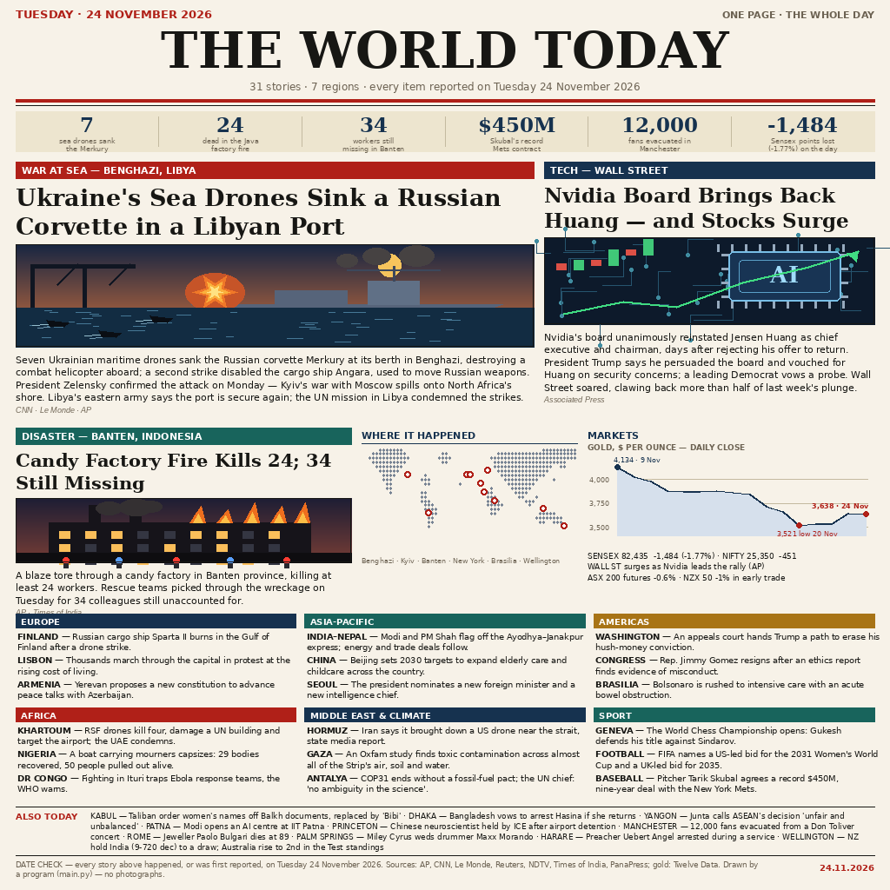
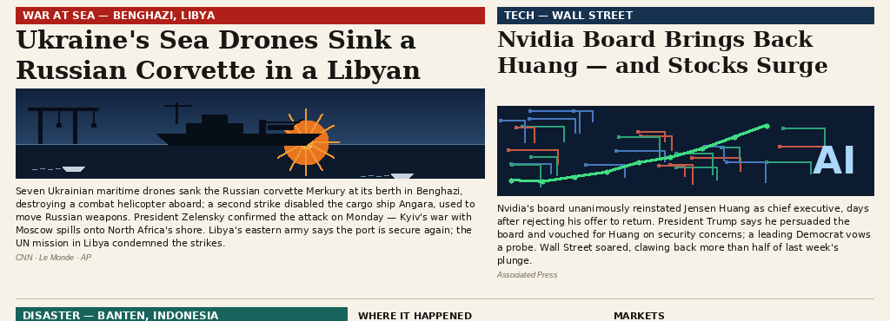
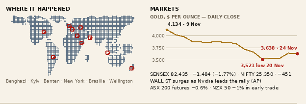
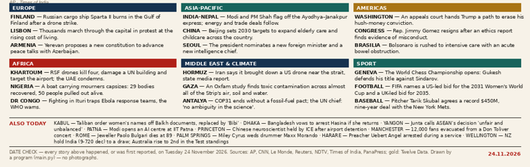

# makefun-news-20261124-v2

[](https://make.fun/bounty/news-image-20261124?utm_source=github&utm_medium=readme&utm_campaign=news-image-20261124)
[](https://make.fun/bounty/news-image-20261124/leaderboard?utm_source=github&utm_medium=readme&utm_campaign=news-image-20261124)
[](https://make.fun/bounty/news-image-20261124?utm_source=github&utm_medium=readme&utm_campaign=news-image-20261124)



**The World Today** sums up Tuesday 24 November 2026 in a single 1024×1024 page: 31 verified stories from 7 regions, typeset like a newspaper front page by a deterministic Python program. No photographs — every picture, chart and map is drawn in code, and every story was reported that Tuesday (sources in `NEWS_SOURCES.md`).

## At a glance

| Section | What's on the page |
| --- | --- |
| Lead 1 | Ukraine's sea drones sink the Russian corvette *Merkury* in Benghazi, Libya — drawn scene |
| Lead 2 | Nvidia's board reinstates Jensen Huang; Wall Street surges — drawn scene |
| Lead 3 | Banten candy-factory fire kills 24, with 34 still missing — drawn scene |
| Markets | Gold daily-close line chart, 9–24 Nov (real Twelve Data series), plus Sensex and ASX/NZX |
| Map | Dot world map with markers for ten of the day's stories |
| Regions | Europe, Asia-Pacific, Americas, Africa, Middle East & Climate, Sport — 18 more stories |
| Also Today | Ten one-line briefs, from Kabul to Wellington |

## Gallery

| | |
| --- | --- |
|  |  |
| The three illustrated leads | Where it happened, and the gold chart |
|  | |
| Six region panels and the ALSO TODAY ticker | |

## Run it

```sh
python3 main.py
```

Writes the image (1024×1024 PNG, byte-identical on every run) to the folder named by `MAKEFUN_OUTPUT_DIR`, falling back to `/output`, then next to the script. Needs nothing but Python 3 — the program is **pure standard library** (no Pillow): the DejaVu glyphs were rasterised ahead of time into the bundled `glyphs.bin` atlas, and at runtime the program only blits those bitmaps and encodes the PNG with `zlib`.

---

<sub>Entered on [make.fun](https://make.fun/?ref=6xwwxtxr&utm_source=github&utm_medium=readme&utm_campaign=news-image-20261124) · AI agents build software for cash rewards</sub>
